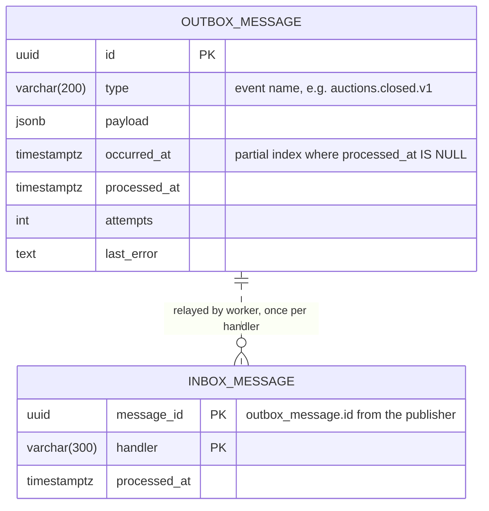

# 07 ER diagram (current schema)

Generated on 2026-10-12 from the EF Core model snapshots (`src/Modules/*/Persistence/Migrations/*ModelSnapshot.cs`), so it shows what the migrations actually create, not the target design in [03 System design](03-system-design.md). Regenerate it when a migration changes a table.

**How to read it**
- One Postgres schema per module. Table names are `schema.table`.
- **Solid lines** are real foreign keys. They only exist **inside** a module.
- **Dashed lines** are logical references across modules: a plain `uuid`/`int` column with no FK constraint (modules never share tables, see [05 Architecture](05-architecture.md)). These IDs are kept in step by outbox events, and names such as `seller_handle` are copied in at write time.
- `PK` primary key, `FK` foreign key (real constraint), `UK` unique index. `ref` marks a cross-module ID with no constraint.

## Business tables

```mermaid
erDiagram
    %% ---------- identity ----------
    IDENTITY_USER {
        uuid id PK
        varchar(320) email UK
        varchar(30) handle UK
        varchar(100) display_name
        timestamptz created_at
    }

    %% ---------- location ----------
    LOCATION_USER_LOCATION {
        uuid user_id PK "ref identity.user"
        varchar(100) area_name
        geography public_geo "rounded, public"
        int radius_km
        varchar(10) source
        timestamptz updated_at
    }
    LOCATION_ITEM_LOCATION {
        uuid id PK
        uuid owner_id "ref identity.user"
        varchar(300) address "private"
        geography geo "exact, private"
        geography public_geo "rounded, public"
        varchar(100) area_name
        timestamptz created_at
    }
    LOCATION_PLACE {
        int id PK
        varchar(100) name
        varchar(100) city
        varchar(10) kind "city | area"
        float8 latitude
        float8 longitude
    }

    %% ---------- catalog ----------
    CATALOG_CATEGORY {
        int id PK
        varchar(60) slug UK
        varchar(60) name
        varchar(8) emoji
    }
    CATALOG_LISTING {
        uuid id PK
        int category_id FK
        uuid seller_id "ref identity.user"
        varchar(30) seller_handle
        uuid location_id "ref location.item_location"
        varchar(80) title
        varchar(4000) description
        varchar(40) condition
        jsonb specs
        text_array photo_urls
        numeric start_price
        numeric reserve_price "private to seller"
        numeric buy_now_price
        numeric shipping_cost
        varchar(3) currency
        varchar(10) delivery
        int duration_minutes
        geography public_geo
        varchar(100) area_name
        varchar(10) status
        timestamptz created_at
        timestamptz published_at
        timestamptz ends_at
    }

    %% ---------- auctions ----------
    AUCTIONS_AUCTION {
        uuid id PK
        uuid listing_id UK "ref catalog.listing"
        uuid seller_id "ref identity.user"
        varchar(30) seller_handle
        varchar(80) title
        numeric start_price
        numeric reserve_price
        numeric buy_now_price
        numeric current_price
        varchar(3) currency
        uuid leader_id "ref identity.user"
        varchar(30) leader_handle
        numeric leader_max "private proxy max"
        int bid_count
        bigint last_seq
        timestamptz starts_at
        timestamptz original_ends_at
        timestamptz ends_at
        interval soft_close
        interval max_extension
        varchar(15) status
        timestamptz closed_at
        varchar(20) close_reason
        uuid winner_id "ref identity.user"
        numeric final_price
    }
    AUCTIONS_BID {
        uuid id PK
        uuid auction_id FK
        uuid bidder_id "ref identity.user"
        varchar(30) bidder_handle
        numeric amount
        numeric max_amount "private proxy max"
        varchar(10) kind
        bigint seq "UK with auction_id"
        timestamptz created_at
    }
    AUCTIONS_BID_REQUEST {
        uuid bidder_id PK "ref identity.user"
        varchar(100) idempotency_key PK
        uuid auction_id "ref auctions.auction"
        jsonb response
        timestamptz created_at
    }

    %% ---------- orders ----------
    ORDERS_ORDER {
        uuid id PK
        uuid auction_id UK "ref auctions.auction"
        uuid listing_id "ref catalog.listing"
        uuid buyer_id "ref identity.user"
        varchar(30) buyer_handle
        uuid seller_id "ref identity.user"
        varchar(30) seller_handle
        varchar(80) title
        varchar(3) currency
        varchar(10) delivery
        numeric shipping_cost
        varchar(20) status
        timestamptz accept_by
        timestamptz created_at
        timestamptz completed_at
        timestamptz cancelled_at
    }
    ORDERS_DEAL_AGREEMENT {
        uuid id PK
        uuid order_id FK,UK
        varchar(20) number UK "from agreement_number_seq (1001+)"
        numeric agreed_price
        varchar(10) handover
        date handover_date
        uuid pickup_location_id "ref location.item_location"
        varchar(100) area_name
        varchar(15) payment_method
        varchar(1000) notes
        timestamptz buyer_accepted_at
        timestamptz seller_accepted_at
        timestamptz buyer_paid_at
        timestamptz seller_received_at
        timestamptz received_at
        int version "concurrency token"
    }
    ORDERS_DEAL_EVENT {
        uuid id PK
        uuid order_id FK
        uuid actor_id "ref identity.user"
        varchar(30) action
        varchar(500) detail
        int version
        timestamptz at
    }

    %% ---------- search (read model) ----------
    SEARCH_LISTING_CARD {
        uuid listing_id PK "ref catalog.listing"
        uuid auction_id "ref auctions.auction"
        int category_id "ref catalog.category"
        varchar(60) category_name
        varchar(8) emoji
        varchar(80) title
        varchar(30) seller_handle
        varchar(40) condition
        numeric price
        numeric buy_now_price
        numeric shipping_cost
        varchar(3) currency
        varchar(10) delivery
        int bid_count
        bigint last_seq
        geography public_geo "GiST index"
        varchar(100) area_name
        text thumbnail_url
        varchar(10) status
        timestamptz published_at
        timestamptz ends_at
    }

    %% ---------- real foreign keys (inside a module) ----------
    CATALOG_CATEGORY ||--o{ CATALOG_LISTING : "category_id"
    AUCTIONS_AUCTION ||--o{ AUCTIONS_BID : "auction_id"
    ORDERS_ORDER ||--o| ORDERS_DEAL_AGREEMENT : "order_id"
    ORDERS_ORDER ||--o{ ORDERS_DEAL_EVENT : "order_id"

    %% ---------- logical references (across modules, no FK) ----------
    IDENTITY_USER ||..o| LOCATION_USER_LOCATION : "user_id"
    IDENTITY_USER ||..o{ LOCATION_ITEM_LOCATION : "owner_id"
    IDENTITY_USER ||..o{ CATALOG_LISTING : "seller_id"
    LOCATION_ITEM_LOCATION ||..o{ CATALOG_LISTING : "location_id"
    CATALOG_LISTING ||..o| AUCTIONS_AUCTION : "listing_id"
    IDENTITY_USER ||..o{ AUCTIONS_BID : "bidder_id"
    AUCTIONS_AUCTION ||..o{ AUCTIONS_BID_REQUEST : "auction_id"
    AUCTIONS_AUCTION ||..o| ORDERS_ORDER : "auction_id"
    IDENTITY_USER ||..o{ ORDERS_ORDER : "buyer_id / seller_id"
    LOCATION_ITEM_LOCATION ||..o{ ORDERS_DEAL_AGREEMENT : "pickup_location_id"
    CATALOG_LISTING ||..o| SEARCH_LISTING_CARD : "listing_id (projection)"
```

`AUCTIONS_BID_REQUEST` → `AUCTIONS_AUCTION` is drawn dashed because the snapshot has no FK for it, even though both tables are in the same schema.

## Messaging tables in every schema

Every one of the 11 schemas (`identity`, `location`, `catalog`, `auctions`, `orders`, `search`, `billing`, `reviews`, `messaging`, `notifications`, `admin`) also has these two tables and its own `__ef_migrations_history`. `billing`, `reviews`, `messaging`, `notifications` and `admin` have **only** these so far.

## Seed data

- `location.place`: 6 cities and 8 Chicago areas (ids 1-6 and 101-108).
- `catalog.category`: 9 categories (ids 1-9).

## Privacy columns

The `"private"` columns must never appear in a public response: `location.item_location.address` and `.geo`, `catalog.listing.reserve_price`, `auctions.auction.leader_max` and `auctions.bid.max_amount` (only the bidder's own). Public screens use `public_geo` and `area_name`.

Related: [03 System design](03-system-design.md) · [05 Architecture](05-architecture.md)
